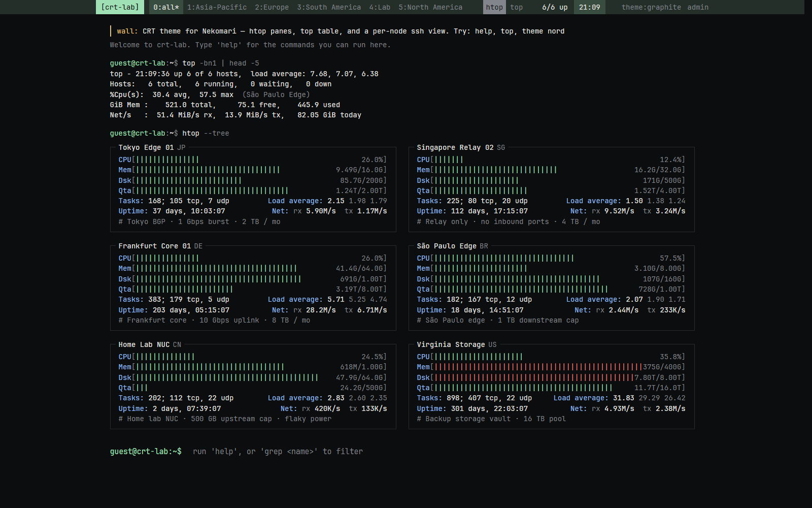

# CRT v1.0.0（不含 ping 图）

这是 CRT 主题的**归档版本**，功能与最初发布的 Komari/Nekomari 移植版一致，**不含**详情页的 ping 延迟/丢包图。给不需要 ping 图、或所在环境不提供 ping 指标的服务端使用。

完整功能与后续更新在 `main` 分支 / 最新 Release：

- 仓库：<https://github.com/Aone2233/komari-theme-crt>
- 最新版本：<https://github.com/Aone2233/komari-theme-crt/releases/latest>
- 完整说明：[main 分支 README](https://github.com/Aone2233/komari-theme-crt/blob/main/README.md)

## 安装

1. 下载本 Release 的 `CRT-v1.0.0.zip`；
2. 后台 → 主题 → 导入，上传 zip；
3. 主题列表里切换到 **CRT**（`short` 是 `CRT`）；
4. **强制刷新页面**（Ctrl+F5 / Cmd+Shift+R）——`app.js`/`style.css` 走协商缓存，普通刷新可能仍是旧文件。

兼容 Nekomari 与 Komari 1.5.0+（含归档前最后一个版本 `1.5.0-fix1`）。

## 与最新版的区别

- 详情页只有 CPU、内存、磁盘、网速四张基础图；没有 `ping latency ms` / `ping loss %`。
- 没有 `ping` 诊断命令。
- 其余（htop 面板 / top 表格、ssh 详情、命令行、六套配色、扫描线、移动端、主题设置）与 v1.1.x 相同。

> 主题清单里的 `url` 指向本仓库，后台的“更新”会取最新 Release。安装 v1.0.0 后如果点了更新，会升级到含 ping 图的版本；只想保持无 ping 版本时不要点更新。

## 许可与致谢

MIT，上游 [kisukri/monitor-theme-crt](https://github.com/kisukri/monitor-theme-crt)，见 [LICENSE](LICENSE)。字体 JetBrains Mono 以 OFL-1.1 分发，见 [FONTS.md](FONTS.md)。
