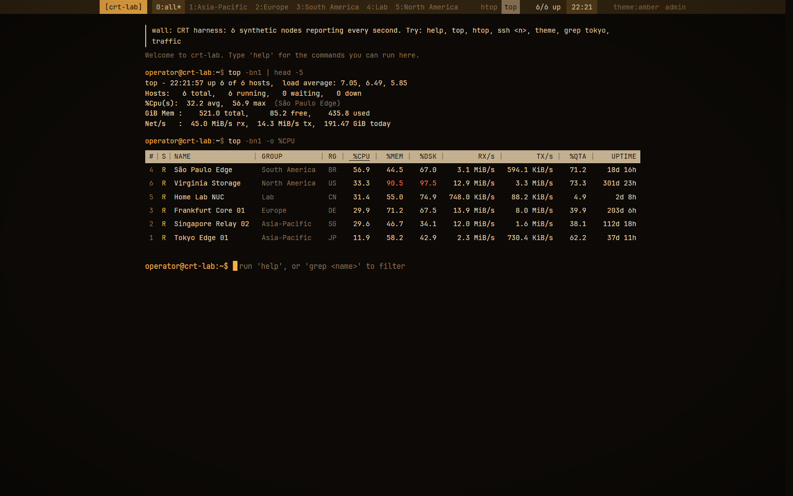
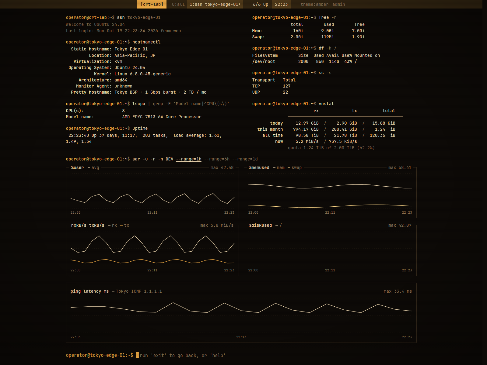
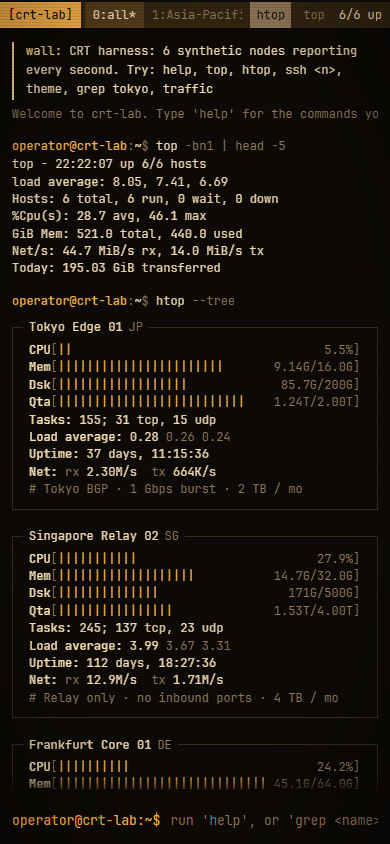

# CRT — 终端风格的 Komari / Nekomari 主题

把服务器状态页做成 `top`、`htop`、`ssh` 的样子：顶栏是 tmux 窗口条，首页是 `top -bn1`
汇总加 htop 面板或 top 表格，点进一台机器就是一段 ssh 会话，底部命令行可以 `ssh`、
`grep`、`cd`、`sort`、`theme`，支持 Tab 补全。


## 预览

<table>
<tr>
<td></td>
<td></td>
</tr>
<tr>
<td align="center">top 表格</td>
<td align="center">ssh 详情 + ping 延迟图</td>
</tr>
</table>

<p align="center"></p>

## 特性

- **htop 面板 / top 表格** 两种视图；分组即 tmux 窗口，`htop`/`top` 一键切换。
- **ssh 会话式详情**：`hostnamectl`、`lscpu`、`uptime`、`free -h`、`df -h`、`ss -s`、`vnstat` 的输出排版。
- **ping 延迟 / 丢包图**：按 ping 任务、地址族（v4/v6）、协议（icmp/tcp）与参考点分线；丢包图只在窗口内确实丢过包时出现。
- **命令行**：`help`、`ssh`、`grep`、`cd`、`sort`、`theme`、`ping`（诊断 ping 数据链路）、`clear`、`exit`、`whoami`、`hostname`、`uptime`、`admin`，Tab 补全。
- **六套配色**：graphite 石墨 / phosphor 磷光绿 / amber 琥珀 / nord 北极蓝 / dusk 暮紫 / paper 纸白；可选扫描线。
- **移动端**可用；字体（JetBrains Mono）随包分发，对齐方块与框线。
- 无构建步骤、无 npm 依赖 —— `dist/` 就是可分发产物。

## 安装

### 后台导入（推荐）

1. 下载 [Releases](../../releases) 里的 `CRT-v1.1.1.zip`；
2. 后台 → 主题 → 导入，上传 zip；
3. 在主题列表里把当前主题切到 **CRT**；
4. **强制刷新页面（Ctrl+F5 / Cmd+Shift+R）**。`app.js`/`style.css` 走协商缓存，普通刷新可能仍沿用旧文件——第一次安装和每次升级后都建议强刷。

> 主题的 `short` 是 `CRT`。如果你之前装过别的 CRT 版本（例如上游的 `crt`），后台里会是两个不同主题，请确认激活的是 `CRT`。

Nekomari 与 Komari 的导入流程相同：都读取 zip 根目录的 `komari-theme.json` 和 `dist/`。

### 目录拷贝

不想走导入流程时，把 `komari-theme.json`、`preview.png` 和 `dist/` 放进：

```text
<数据目录>/theme/CRT/
├── komari-theme.json
├── preview.png
└── dist/
    ├── index.html
    ├── app.js
    ├── style.css
    ├── favicon.svg
    ├── apple-touch-icon.png
    └── fonts/*.woff2
```

再在后台把主题切到 CRT。不要解压到 `frontend/dist`，也不要把 `dist/` 的内容摊平到主题根目录。

### 升级

再次导入同名 zip 即可覆盖，主题设置与访客的配色偏好（`localStorage`）都会保留；升级后同样强制刷新。主题清单里的 `url` 指向本仓库，Nekomari 后台的“更新”会取 GitHub 最新 Release 的第一个资源（即本 zip）。

## 兼容性

面向 **Nekomari** 与 **Komari**（含归档前最后一个版本 `1.5.0-fix1`）。

| 能力 | 依赖的接口 |
|---|---|
| 节点列表、机型/分组/额度 | `common:getNodes` |
| 实时状态（2 秒轮询） | `common:getNodesLatestStatus` |
| 站点名、历史天数、主题设置 | `/api/public`（`sitename`、`record_preserve_time`、`theme_settings`） |
| 登录状态 | `/api/me` |
| 详情页基础曲线 | `/api/records/load` |
| 今日/本月流量 | `public:queryMetrics`（`traffic.*`；今日只累加 `interval_delta_v2` 语义的区间增量） |
| ping 延迟/丢包图 | `public:getPublicPingTasks` + `public:queryMetrics`（`ping.latency_ms` / `ping.loss`，有 `ping.success_latency_ms` 时优先） |
| ping 记录兜底 | `/api/records/ping` |

- 上述接口在 Komari `1.5.0` 起就存在；Nekomari 沿用并扩展了同一套接口。
- 较新的 agent 才会上报计费周期流量与 `ping.success_latency_ms`；缺失时主题自动回退，不会报错、也不会多出空图。
- 今日流量如果探针没有区间流量（旧 agent），显示 0；本月/累计仍可用。

## 主题设置

后台 → 主题 → CRT 设置：

| 键 | 类型 | 默认 | 说明 |
|---|---|---|---|
| `palette` | select | `graphite` | 访客首次看到的配色 |
| `allow_switch` | switch | `true` | 是否允许访客自己换配色 |
| `scanlines` | switch | `false` | CRT 扫描线叠加层 |
| `username` | string | `guest` | 提示符里的访客用户名 |
| `hostname` | string | 空 | 提示符里的主机名；空则用小写站点名 |
| `notice` | textbox | 空 | 页面顶部公告（纯文本） |
| `show_summary` | switch | `true` | 是否显示 top 汇总区 |
| `default_view` | select | `grid` | 首次打开的视图：grid = htop，list = top |
| `show_remark` | switch | `true` | 是否显示节点公开备注 |
| `show_admin` | switch | `true` | 顶栏是否显示后台入口 |

访客自己切过配色/视图后，以访客的 `localStorage` 选择为准。

## 与上游的区别

上游是 [kisukri/monitor-theme-crt](https://github.com/kisukri/monitor-theme-crt)，写给另一个探针后端（Monitor），接口与数据模型都不同。本仓库保留其界面、配色、字体与命令行，重写了数据层并重新打包：

- 数据源改为 Komari/Nekomari 的 `common:getNodes`、`common:getNodesLatestStatus`、`/api/records/load`、`public:queryMetrics`、`/api/public`。
- 新增 **ping 延迟/丢包图**（上游 CRT 没有）。
- 节点 `region` 是自由文本（可能带旗帜 emoji），表格与面板里归一为两字母代码显示，避免字体缺字形时出现豆腐块。
- 移除了 Monitor 后端的 `/api/ws`、`/api/themes/<short>/config`、`/nodes/<id>/metrics` 等调用。

## 已知限制

- 访客看不到 agent 版本与私有备注（服务端脱敏）；管理员登录后正常。
- 私有站点未登录时显示 `sign in →`，主题本身不实现登录表单。
- 详情页基础曲线只有 CPU、内存、磁盘、网速四条（记录表不含 `cpu_max`）。
- ping 图需要节点分配了 ping 任务且窗口内有数据；刚配置任务时通常要等几分钟才有两个以上时间桶，长区间在数据积累前可能显示 `sar: no ping samples in this range`。
- 第一次安装/升级后如果看不到变化，先强制刷新。

## 开发

`dist/` 即产物，直接编辑即可，无需构建。仓库根目录提供两个校验脚本（Node 18+）：

```bash
node tools/check.mjs     # 清单结构、资源引用、旧后端残留调用
node tools/package.mjs   # 生成 CRT-v<version>.zip
```

## 许可与致谢

- 主题代码：MIT，Copyright (c) 2026 [kisukri](https://github.com/kisukri)（上游），见 [LICENSE](LICENSE)。
- 本移植：同样以 MIT 发布。
- 字体：[JetBrains Mono](https://github.com/JetBrains/JetBrainsMono)，SIL Open Font License 1.1，见 [FONTS.md](FONTS.md)。
- 上游灵感：[akanotanin/monitor-theme-tty](https://github.com/akanotanin/monitor-theme-tty)。

## English

A terminal-style theme for [Komari](https://github.com/komari-monitor/komari) and [Nekomari](https://github.com/Aone2233/Nekomari): the status page is rendered as `top`, `htop` and `ssh` output, with a tmux-style top bar, an interactive command line (`help`, `ssh`, `grep`, `cd`, `sort`, `theme`, `ping`), six palettes, and per-node ping latency/loss charts on the detail page.

Install: download `CRT-v1.1.1.zip` from [Releases](../../releases), import it in the admin → theme page, activate **CRT**, then **hard-refresh** the browser (`Ctrl+F5`). Compatible with Komari `1.5.0`+ (including the last archived release `1.5.0-fix1`) and Nekomari. Ported from [kisukri/monitor-theme-crt](https://github.com/kisukri/monitor-theme-crt) (MIT); the UI is unchanged, the data layer was rewritten for Komari's public APIs and ping charts were added.
